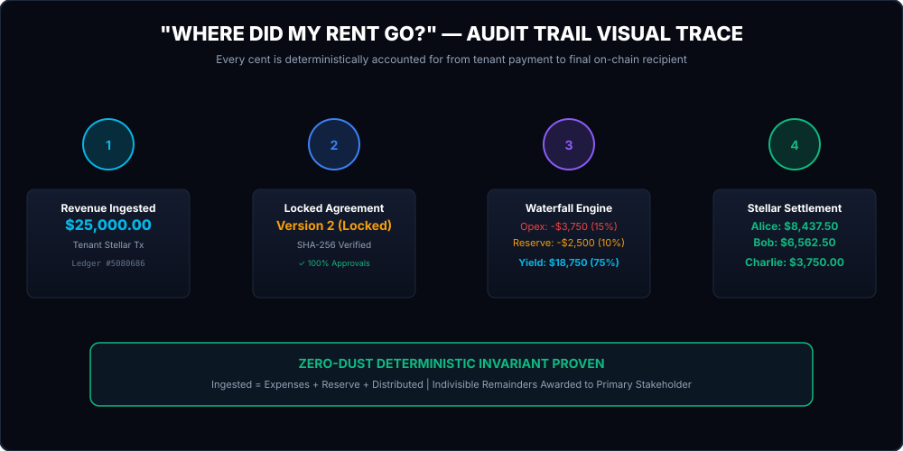

# 🏠 Stellar Estate Frontend (`stellar-estate-frontend`)

> **Programmable Real-World Asset (RWA) Property-Revenue Settlement Web Application — Interactive Trace, Financial Passport & Non-Custodial Stellar Execution**

[](https://stellar-estate-app.netlify.app)
[](https://stellar.org)
[](https://react.dev)
[](https://github.com/Stellar-Estate/stellar-estate-frontend)
[](LICENSE)

**🌐 Live Production Platform:** [https://stellar-estate-app.netlify.app](https://stellar-estate-app.netlify.app)  
**⚖️ Hackathon Judges Evaluation Guide:** [docs/JUDGES_GUIDE.md](https://github.com/Stellar-Estate/stellar-estate-core/blob/main/docs/JUDGES_GUIDE.md)  
**🏛️ Core & Smart Contracts Repository:** [`Stellar-Estate/stellar-estate-core`](https://github.com/Stellar-Estate/stellar-estate-core)  

---

## Platform Preview


---

## 1. Product Thesis & Architecture

Stellar Estate turns real-estate rental and operating revenue into programmable, transparent, and instantly settleable financial flows on the Stellar network.

$$\text{Property (RWA)} \longrightarrow \text{Revenue Deposit} \longrightarrow \text{Vault} \longrightarrow \text{Locked Agreement} \longrightarrow \text{Waterfall Engine} \longrightarrow \text{Multi-Recipient Settlement} \longrightarrow \text{Reconciliation Proof}$$

The user experience solves the multi-billion dollar opacity problem for property owners, syndicate operators, and fractional investors:
> **“Property revenue came in on-chain. According to the locked agreement, where exactly did every single dollar and stroop go?”**

### "Where Did My Rent Go?" Visual Lineage Trace



---

## 2. Key Modules & User Capabilities

### 1. "Where Did My Rent Go?" Interactive Trace (`/settlements`)
* Complete step-by-step visual audit trail displaying how verified tenant revenue flows through deterministic waterfall rules into stakeholder payouts.
* Direct links to:
  * Ingested revenue deposit transaction on StellarExpert Explorer.
  * Locked distribution agreement version and canonical SHA-256 agreement hash.
  * Individual recipient payout transactions with on-chain transaction hashes.
  * On-chain mathematical zero-dust invariant verification badge.

### 2. Multi-Recipient Settlement Execution
* Preview deterministic waterfall calculations before funds move on-chain.
* Non-custodial execution flow: `PREVIEW` $\rightarrow$ `SIGNING` $\rightarrow$ `SUBMITTING` $\rightarrow$ `CONFIRMING` $\rightarrow$ `SETTLED` $\rightarrow$ `RECONCILED`.
* Double-spending protection: Ingested revenue records are consumed once and cannot be re-settled.

### 3. Property Financial Passport (`/detail/:id`)
* Permanent verifiable financial history tracking lifetime statistics:
  * Total Lifetime Revenue Ingested
  * Total Operating Expenses Deducted
  * Total Maintenance Reserves Held in Vault
  * Total Management Fees Paid
  * Total Distributed to Stakeholders
  * Total Settlements Executed
  * Active Agreement Version & Canonical SHA-256 Hash
  * Cross-Ledger Reconciliation Health (`✓ CURRENT • 100% Balanced`)

### 4. Stakeholder Consensus & Governance (`/agreements`)
* Propose agreement versions with waterfall deductions and stakeholder basis points ($10,000 \text{ bps} \equiv 100.00\%$).
* Multi-party cryptographic consensus approvals against canonical 64-character SHA-256 agreement hashes.
* Immutable contract locking on Soroban once 100% stakeholder consensus is attained.

### 5. Audit & Compliance Station (`/audit`)
* Cross-ledger discrepancy detector comparing local state against Horizon validators.
* Real-time network protocol health, base fees, and ledger sequencing monitor.
* Automated audit log with filterable entities and transaction verification proofs.
* Interactive JSON audit bundle downloader for hackathon judges and auditors.

---

## 3. Technology Stack

* **Framework:** React 19, TypeScript, Vite
* **Styling:** Tailwind CSS + Vanilla glassmorphism design system with custom HSL dark mode
* **Icons:** Lucide React
* **Stellar Integration:** `@stellar/stellar-sdk` (Protocol 22 Horizon & Soroban RPC)
* **Wallet Adapter:** Non-custodial Freighter Wallet integration
* **Testing:** Vitest automated test suite (**88 / 88 passing**)
* **Deployment:** Netlify Production with automated SPA routing, caching headers & CSP (`netlify.toml`)

---

## 4. Local Development & Verification

### Prerequisites
* Node.js v18.0.0 or higher
* npm v9.0.0 or higher
* Modern web browser with Freighter wallet extension (configured to Stellar Testnet)

### Commands
```bash
# Install dependencies
npm install

# Run Frontend Component & Integration Tests (88/88 Passing)
npm test

# Typecheck TypeScript code
npm run lint

# Build optimized production bundle
npm run build

# Start local Vite development server (Port 5173)
npm run dev
```

---

## 5. Production Netlify Deployment

The application is deployed on Netlify with automated continuous deployment from `main`:
* **Live URL:** [https://stellar-estate-app.netlify.app](https://stellar-estate-app.netlify.app)
* **Configuration:** Defined in `netlify.toml` with strict CSP headers, asset caching, and SPA redirect fallbacks (`/* -> /index.html 200`).
* **Environment Configuration:**
  * `VITE_API_URL` — Backend API endpoint
  * `VITE_STELLAR_NETWORK` — `TESTNET`
  * `VITE_HORIZON_URL` — `https://horizon-testnet.stellar.org`

---

## 6. License

Licensed under the **Apache License 2.0** — see the [LICENSE](LICENSE) file for details.
